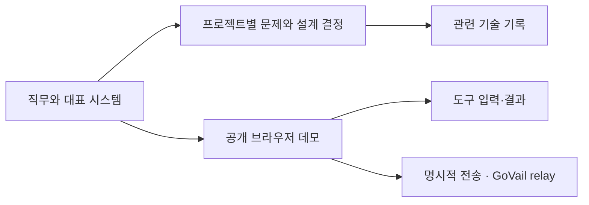
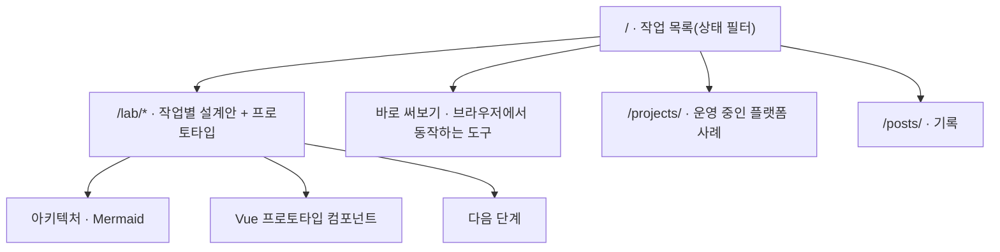
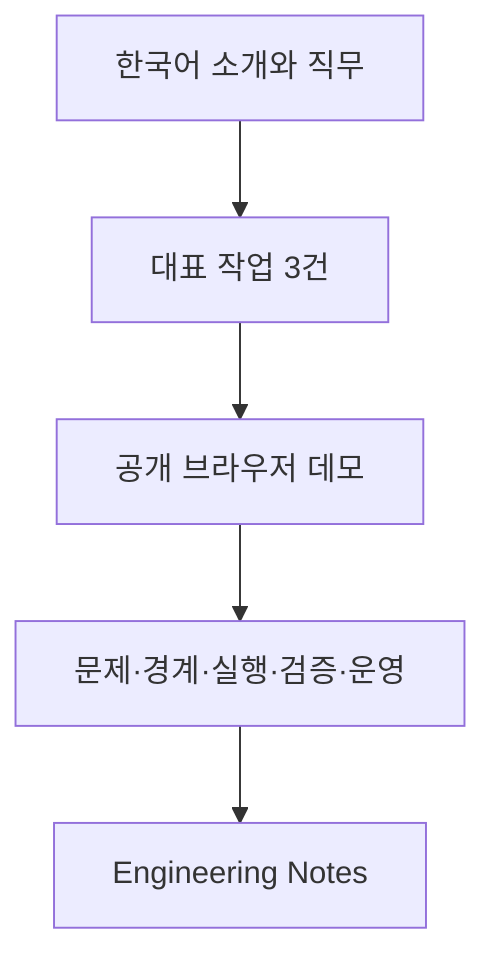
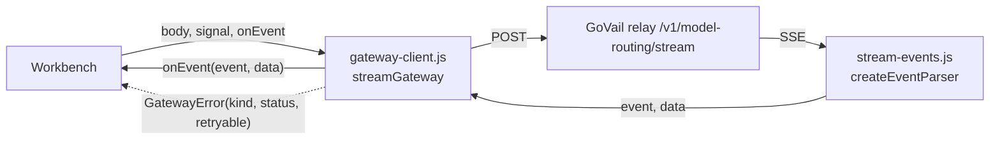
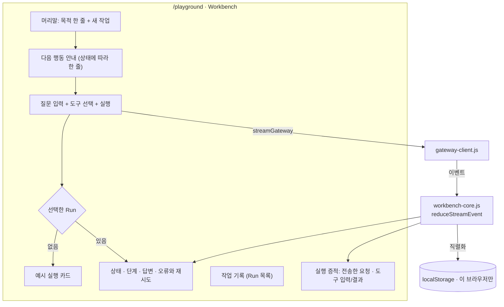

# devcy0922.github.io 아키텍처

## 목표

이 저장소는 `devcy0922.github.io`에 배포되는 Backend & AI Platform Engineer 포트폴리오다. 기술 글은 프로젝트의 판단 근거로 연결한다.

## 포트폴리오 개편 · 2026-09

- 홈: 경력과 직무 → 대표 시스템 → 실행 가능한 데모 → 설계 원칙 → 기록.
- 대표 프로젝트 데이터는 `docs/selected-projects.js`에서 문제, 결정, 확인 경로를 함께 관리한다.
- `/playground`는 `govail/thinker`에 실제 요청을 보내는 콘솔 화면이다. 선택한 도구의 입력과 relay가 반환한 결과만 표시한다.
- 내부 chain-of-thought나 사설 노드 정보는 노출하지 않는다. 관찰 가능한 SSE 이벤트와 도구 결과만 증적으로 남긴다.
- 라이브 콘솔은 빈 작업 기록으로 시작한다. 네트워크 오류는 오류로 표시하며 초기 운영 수치 fixture를 넣지 않는다.
- 비공개 프로젝트는 로컬 문서의 공개 가능한 책임 경계만 설명한다. 인증정보, 업무 데이터, 내부 주소는 데모에 복제하지 않는다.



제품 문서와 개인 기록을 분리한다. GoVail을 포함한 프로젝트는 글과 프로젝트 사례 중 하나일 뿐이며 사이트의 전역 내비게이션, 번역 체계, 런타임 의존성으로 연결하지 않는다.

## 2026-10 개편 · AX Lab

> 이 섹션이 위의 2026-09 홈 구성보다 우선한다.

제품 소개 사이트로 구성한다(포트폴리오 형식 아님). 목표: 방문자가 10초 안에 "아이디어가 많고, 화면이 깔끔하고, 실제로 돌아가는 데이터다"라고 판단하게 한다.
홈 첫 화면은 브랜드 문장과 실제 제품 화면이고, 바로 아래가 **제품 그리드**다. 제품 페이지는 `layout: page` + `.product-body`이며 히어로(`ProductHero`)와 이전/다음 제품(`LabPager`)은 레이아웃 슬롯이 자동으로 붙인다. 모든 작업은 `운영 중 · 프로토타입 · 설계` 중 하나의 상태를 갖고, 상태는 실제 구현 범위와 일치해야 한다.



### 데이터

- `docs/lab-projects.ts` — 작업 목록의 단일 출처(SSOT). id, 제목, 상태, 영역, 한 줄 설명, 스택, 바로 써보기 여부.
- 홈(`WorkIndex.vue`)과 `/lab/` 목록, 각 상세 헤더(`LabHeader.vue`)가 모두 이 파일만 읽는다.

### 프로토타입 원칙

| 작업 | 화면에서 실제로 동작하는 것 | 동작하지 않는 것(명시) |
|---|---|---|
| 지니언스 공개자료 RAG | 질의 → 공개자료 필터 → 검색 → 인용 검증 파이프라인 UI, 출처 레지스트리 | 코퍼스 수집·답변 생성(설계 단계) |
| GoVail UI 리뉴얼 | 변경 기록, 캡처 슬롯, 콘솔 링크 | 캡처 이미지(촬영 예정 구도만) |
| vibe-post-it | 사업보고서 diff(jsdiff), Slack 레거시 attachment → Block Kit 변환과 언어별 전송 샘플 | 서버 측 저장 |
| NS 트레이딩 | 공개 가능한 구조·안전 계약 | 포지션·종목·수익 |
| 새벽온 | 정보 구조, GCP/Terraform/Ansible 배포 설계, 캡처 구도 | 실제 GCP 리소스 |
| 웹페이지 빌더 | GrapesJS 기반 영역 선택·폰트 조절·HTML 내보내기 | 저장/협업 |
| 금연 넛지 | 걸음·좌식 시간 규칙 기반 넛지 시뮬레이터 | Android 센서 연동(설계) |
| Lingo 도메인 번역 | 용어집 기반 도메인 판정·용어 고정 번역(LLM 미사용) | 대규모 TM |
| vibe-mcp | `mcp-*` 모노레포 구조·Makefile 계약 | 서버 구현 |
| 실행 샌드박스 | 계층별 차단 판정 시뮬레이터, 위협 모델 | 실제 격리 실행 |

- 브라우저 프로토타입은 서버를 호출하지 않는다(기존 `/playground`만 예외).
- 예시 입력은 화면에 "예시"로 표시하고, 실제 회사 내부 자료·포지션·고객 데이터는 넣지 않는다.
- 무거운 OSS(GrapesJS)는 해당 페이지의 `onMounted`에서 동적 import 해 SSR 빌드와 다른 페이지 번들에 영향을 주지 않는다.

### 테마

라이트 고정(`appearance: false`). 흰 바탕, 먹색 텍스트, 상태색 3개, 형광펜 노랑 하이라이트 1개. 세부 토큰은 `DESIGN.md`.

## 정보 구조

```mermaid
flowchart LR
    Home["/ · 개발자 홈"] --> Posts["/posts/ · 기술 글"]
    Home --> Projects["/projects/ · 선택한 작업"]
    Home --> About["/about · 경험과 관심사"]
    Posts --> Article["/posts/* · 개별 글"]
    Projects --> Case["/projects/* · 프로젝트 사례"]
```



### `/`

첫 화면에서 다음 세 가지가 보여야 한다.

1. 어떤 개발자인가
2. 어떤 시스템을 설계하고 구현했는가
3. 어디에서 설계와 동작을 확인할 수 있는가

### `/posts/`

날짜순 기술 글 아카이브다. `docs/posts.data.js`가 Markdown frontmatter를 읽어 목록을 생성한다.

새 글은 다음 형식을 따른다.

```yaml
---
title: "글 제목"
date: 2026-08-26
description: "목록과 검색 결과에서 사용할 한 문장"
tags:
  - AI Platform
  - Architecture
---
```

### `/projects/`

프로젝트 개수보다 문제, 책임 경계, 보장 범위를 우선한다. 공개 레포가 실험/데모 목적이면 해당 페이지에서 명시한다.

### `/about`

이력서 복제가 아니라 어떤 문제를 다뤄왔고 지금 어디에 집중하는지 설명한다.

## Build

- VitePress 1.6.x
- Markdown source: `docs/`
- Custom theme extension: `docs/.vitepress/theme`
- Mermaid: `vitepress-plugin-mermaid`
- Search: VitePress local search
- Sitemap: VitePress sitemap
- RSS: `buildEnd`에서 `createContentLoader`로 생성
- Deploy: GitHub Actions → GitHub Pages

## 유지 원칙

- 글 작성에 별도 CMS가 필요 없어야 한다.
- 홈 목록은 글을 추가하면 자동 갱신되어야 한다.
- 빌드 시점 외 네트워크나 서버 런타임을 요구하지 않는다.
- 클라이언트에서 번역 JSON이나 데모 API를 로드하지 않는다.
- 사이트 기능보다 콘텐츠 작성 비용을 낮추는 것을 우선한다.

## 2026-09 UI 개편

홈은 방문자가 가장 먼저 확인해야 할 순서에 맞춰 `소개 → 대표 작업 → 공개 데모 → 설계 기준 → 기록`으로 구성한다.
대표 작업은 `selected-projects.js`의 앞선 세 사례만 홈에 노출하고, 전체 목록과 실험은 `/projects/`에서 계속 제공한다. 화면의 정보 밀도는 얇은 구분선과 여백으로 조절하며, 프로젝트 내용을 임의의 성과 수치나 장식용 카드로 바꾸지 않는다.



기본 폰트는 한국어 본문 가독성을 위해 Noto Sans KR을 사용하고, IBM Plex Mono는 날짜·상태·코드처럼 실제 유틸리티 정보에만 사용한다. 전체 톤은 기존 `Paper / Ink / Cobalt` 토큰을 유지한다.

## 공개 라이브 콘솔

`/playground`가 단일 콘솔 화면(`Workbench`)이다. 사용자가 실행할 때만 `https://api.govail.cloud/v1/model-routing/stream`을 호출하고, 모델은 `govail/thinker`, reasoning effort는 `low`로 고정한다. 브라우저 기록과 relay 서버의 처리 범위는 구분한다. 운영 데이터 fixture나 실패 시 성공 응답으로 바꾸는 폴백은 없다. `/live-console`·`/runner`·`/audit`은 예전 주소를 위한 이동 안내 페이지다.

클라이언트 진행 표시는 관찰 가능한 이벤트만 반영하며 서버 내부 실행 전체나 추론 과정을 나타내지 않는다. relay의 배포·인증·운영 설정은 이 저장소의 변경 범위 밖이다.

## Gateway 스트림 클라이언트

relay 호출은 화면 수와 무관하게 `docs/gateway-client.js`의 `streamGateway` 하나만 소유한다. 화면마다 fetch·SSE 파싱·오류 문구를 따로 구현하면 청크 경계 처리와 실패 표시가 어긋나므로(실제로 Runner에서 이벤트가 유실되었다), 화면은 이벤트를 받아 표시하는 일만 한다.



| kind | 의미 | 화면 표시 |
|---|---|---|
| `http` | relay가 상태 코드로 응답 | 상태 코드를 담은 한국어 문구. 응답 본문(HTML 오류 페이지 등)은 싣지 않는다 |
| `network` | 연결 실패 | 브라우저는 DNS·TLS·CORS 헤더 없는 게이트웨이 장애(502 등)를 구분하지 못하므로 한 문구로 안내한다 |
| `incomplete` | 완료 이벤트(`done`·`error`·`[DONE]`) 없이 스트림 종료 | 시간 제한이나 중간 프록시 차단 가능성을 안내한다. 성공으로 마감하지 않는다 |
| `aborted` | 사용자 중단 | 오류가 아닌 중단으로 표시한다 |

규칙: 깨진 JSON 프레임은 스트림을 끊지 않고 건너뛰며 건너뛴 수를 결과로 돌려준다. `onEvent`에서 던진 예외는 화면 코드의 문제이므로 `GatewayError`로 감싸지 않는다. 실패한 실행은 사유와 다음 행동(다시 시도·질문 수정)을 결과 영역에 먼저 보여 주고, `error` 이벤트로 끝난 실행을 성공으로 기록하지 않는다. 새 화면이 relay를 호출할 때도 `fetch`를 직접 쓰지 않는다.

## 콘솔 화면 구조 (Workbench)

### 왜 합쳤나

Playground(대화형)와 Runner(작업형)는 같은 relay에 같은 도구를 호출하는 화면이었다. 방문자는 "무엇을 하는 곳인지, 지금 무엇을 해야 하는지"를 두 화면 모두에서 알 수 없었다. 원인은 세 가지였다.

- 첫 화면에 선택지가 한꺼번에 나왔다(도구 칩 5개, 예시 칩 5개, 모델 배지, 저장 안내).
- 대화처럼 보이지만 질문마다 독립 요청이었다. 이전 내용은 요약본이 붙을 때만 전달되었다.
- 실제 이벤트에서 나오지 않은 값(승인 해시, 증거 파일명, 고정된 단계 지연)이 섞여 있었다.

### 모델: 작업(Run) 하나 = 질문 → 증적 → 답변

한 번의 실행을 `Run`으로 다룬다. `Run`은 질문, 요청한 도구, 도구 호출(입력·결과·시간), 답변, 상태(`running · done · error · aborted`), 실패 사유를 가진다. 후속 질문은 새 `Run`이다. 이전 내용을 요약해 덧붙이는 동작은 하지 않는다.

[adm-dashboard-preview](https://github.com/devcy0922/adm-dashboard-preview)에서 가져온 패턴: 목록은 "업무 항목"처럼 `Run` 기록으로, 한 줄 설명과 단 하나의 주 동작(+ 새 작업), 빈 상태가 다음 행동을 알려 주는 안내, 실패는 원인·재시도·수정 경로를 갖는 오류 화면, 좁은 화면에서는 표 대신 한 열 카드.



### 규칙

- 순수 로직(도구 결정, 이벤트 → `Run` 변환, 단계 표시, 다음 행동 문구, 저장·이전 형식 변환)은 `docs/workbench-core.js`가 소유하고 `node --test`로 검증한다. Vue 컴포넌트는 상태를 그리기만 한다.
- 단계 표시는 실제로 받은 이벤트에서만 계산한다. 이벤트가 없으면 완료로 표시하지 않고, 실행 중이던 기록이 새로고침으로 끊기면 `실패(중단됨)`로 복원한다.
- 예시 카드는 요청할 도구를 명시한다. 자동 선택일 때도 실제로 전송할 도구를 입력창 아래에 미리 보여 준다.
- 입력창은 항상 맨 위에 둔다. 결과는 그 아래에 쌓이고, 도구 입력·결과는 오른쪽 증적(좁은 화면에서는 아래)에 둔다.
- 예전 주소 `/live-console`·`/runner`·`/audit`은 `/playground`로 이동시킨다. 예전 `govail_playground_browser_cache_v5` 기록은 첫 로드에 `Run`으로 변환해 가져온다.
- 지원하지 않는 것: 승인 게이트 연출, 증거 캡처 파일명·해시 같은 시뮬레이션 값, 대화 요약 덧붙이기.
