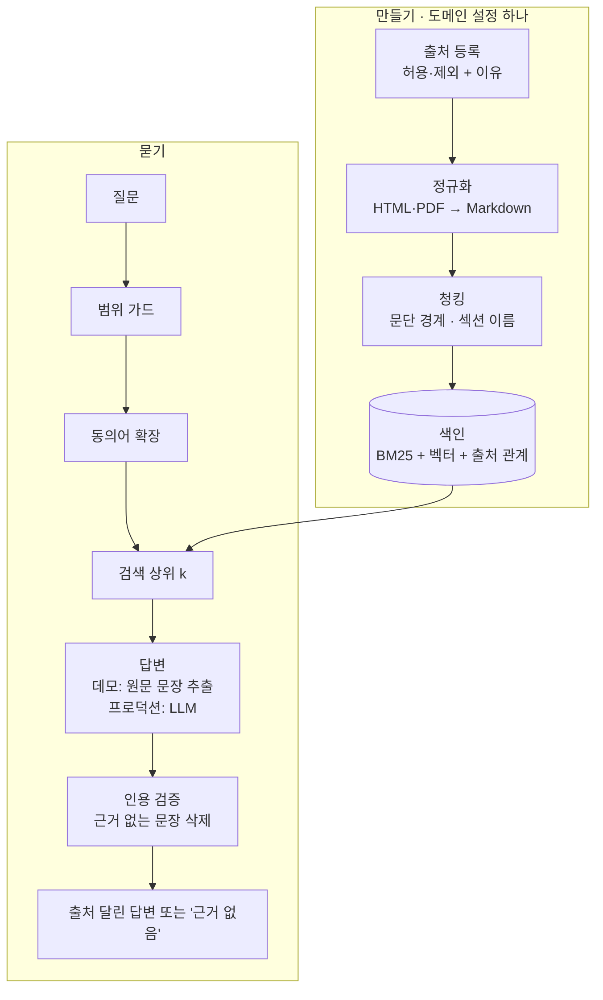

도메인을 고르면 RAG를 처음부터 만듭니다. 왼쪽은 만드는 과정, 오른쪽은 만든 RAG에 묻는 화면입니다. **직접 넣기**를 고르면 원하는 이름과 글로 나만의 도메인을 만들 수 있습니다. 모든 처리는 이 브라우저 안에서 끝납니다.

<DomainRag />

<ProductFeatures />

## 이런 문제를 풉니다

사내 규정, 제품 기술 문서, 공개자료처럼 **답이 이미 문서에 있는** 질문이 매일 반복됩니다. 일반 챗봇은 그럴듯하지만 출처 없는 답을 만들고, 도메인이 바뀔 때마다 수집기·색인·거절 규칙을 처음부터 다시 짭니다.

그래서 도메인이 바뀌어도 파이프라인은 그대로 두고 **도메인 설정 하나**만 바꿉니다. 그리고 출처를 댈 수 없으면 답하지 않습니다.

## 도메인 설정

도메인 하나는 아래 네 가지로 정해집니다. 위 데모의 세 도메인도 이 형식 그대로입니다.

| 항목 | 하는 일 | 예: 사내 규정 |
|---|---|---|
| 이름 | RAG의 제목이자 검색 범위의 이름 | `사내 규정` |
| 출처 | 수집할 문서와 **수집하지 않을 문서**(이유 포함) | 휴가·출장·재택·보안·복리후생 / 인사평가 기준·급여표 제외 |
| 범위 가드 | 검색 전에 돌려보낼 질문 규칙 | 보상·평가, 계정, 개인정보 |
| 동의어 | 질문과 문서의 말이 다를 때 잇는 사전 | 연차 ↔ 휴가, 밥값 ↔ 식대 |

## 동작 방식 {#how}

<DiagramFrame caption="데모는 회색 단계를 브라우저 안의 BM25로 대신합니다. 프로덕션은 같은 단계를 SurrealDB 한 곳에 저장합니다.">

</DiagramFrame>

- **출처 등록**: 수집하지 않는 문서도 목록에 남기고 이유를 적습니다. 무엇을 뺐는지가 보여야 범위를 믿을 수 있습니다.
- **청킹**: 문단 경계를 지키며 240자 이하로 자르고, 제목은 조각의 섹션 이름으로 붙입니다. 제목은 검색에는 쓰고 답변 문장에는 넣지 않습니다.
- **색인**: 한국어는 조사가 붙어 단어 단위로는 잘 맞지 않아서 한글을 2글자 단위로 자릅니다. 질문 쪽에서는 의문형 어미와 조사를 뗍니다.
- **인용 검증**: 질문 말의 3분의 1 이상이 겹치는 문장만 근거로 쓰고, 그 문장이 인용한 조각 원문에 실제로 있는지 다시 확인합니다. 남는 문장이 없으면 "근거 없음"으로 멈춥니다.

## 데모와 프로덕션

| | 데모(이 페이지) | 프로덕션(준비 중) |
|---|---|---|
| 도메인 | 3개 + 직접 넣기 | 제한 없음. 도메인 설정 파일로 등록 |
| 수집 | 미리 넣은 글 | 허용 URL·robots.txt 확인 후 하루 한 번 수집, 원본 해시 보관 |
| 저장·검색 | 브라우저 메모리, BM25 | SurrealDB: 조각·BM25·HNSW 벡터와 `출처 → 문서 → 조각` 관계를 한 DB에 |
| 답변 | 원문 문장 추출 | GoVail Gateway로 생성, 같은 인용 검증기 통과분만 |
| 회사 데이터 | 가상 회사(예시전자·예시보안)와 이 사이트 제품 목록 | 도메인마다 검색 범위 분리 |

## 로드맵

1. 범위 가드·출처 증적 원장·인용 검증기 — **완료**(Python, 실제 사이트 대상 probe 1회)
2. 브라우저 데모 — **완료**(이 페이지)
3. 도메인 설정 파일 하나로 RAG를 만드는 범용 저장소로 정리
4. SurrealDB 저장소와 수집 배치
5. 도메인 등록 화면, LLM 답변과 인용 검증 연결
6. 도메인마다 평가 질문으로 인용 정확도·거절 정확도 측정

