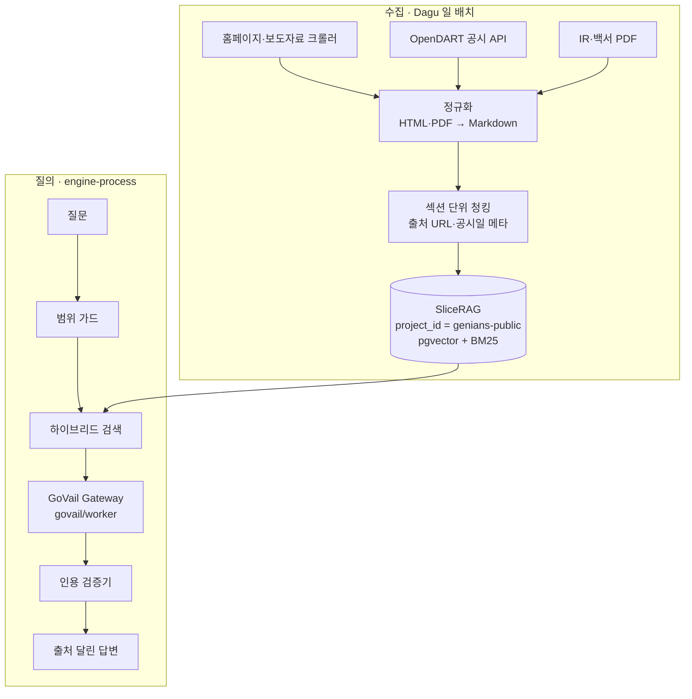

질문 거르기 규칙과 단계 표시는 실제로 동작합니다. 색인을 만들기 전이라 검색 결과는 항상 0건이고, 그래서 답변도 "근거 없음"에서 멈춥니다. 이 멈춤이 설계의 핵심입니다.

<RagSkeleton />

<ProductFeatures />

## 이런 문제를 풉니다

제품 문의, 신입 온보딩, 영업 준비에서 같은 질문이 반복됩니다. 답은 대부분 이미 홈페이지, 보도자료, 공시에 있습니다. 문제는 자료가 흩어져 있고, 일반 챗봇은 그럴듯하지만 출처 없는 답을 만든다는 점입니다.

그래서 범위를 처음부터 좁힙니다. **누구나 볼 수 있는 공개자료만** 쓰고, **출처를 댈 수 없으면 답하지 않습니다.** 내부 문서를 섞지 않기 때문에 회사 밖에서도 보여줄 수 있는 데모가 됩니다.

> 회사 이름과 자료를 쓰는 작업이므로 외부에 공개하기 전에 회사의 확인을 받습니다. 지금 이 페이지는 설계안과 화면 뼈대만 담고 있습니다.

## 동작 방식 {#how}

<DiagramFrame caption="수집은 하루 한 번 배치로, 질의는 engine-process 런타임에서 처리합니다. 검색 범위는 project_id로 고정합니다.">

</DiagramFrame>

이미 운영 중인 부품을 조립합니다. 검색 범위 격리는 [SliceRAG](/projects/slicerag), 모델 호출과 감사 로그는 [GoVail Gateway](/projects/govail-gateway), 도구 호출 루프는 engine-process가 맡습니다. 새로 만드는 것은 수집기, 범위 가드, 인용 검증기 세 가지입니다.

## 설계 결정

| 결정 | 이유 |
|---|---|
| 수집기는 허용한 URL 접두어만 호출 | 로그인이 필요한 경로나 사내 시스템에 실수로 닿지 않게 합니다. |
| 사내 문서와 저장소·색인 분리 | 같은 SliceRAG라도 공개용 project_id를 따로 두어 섞일 여지를 없앱니다. |
| 출처 없는 문장은 지우고, 남는 문장이 없으면 답하지 않음 | 틀린 답보다 "모른다"가 회사 이름을 걸었을 때 덜 위험합니다. |
| 공시는 공시일 기준으로 버전 보관 | 작년과 올해 보고서를 비교하는 [사업보고서 diff](/lab/vibe-post-it#report-diff)와 같은 데이터를 씁니다. |
| 질문 범위 가드는 규칙 먼저, 모델은 나중 | 인사·고객·주가 질문은 검색 전에 돌려보내 비용과 위험을 같이 줄입니다. |

## 평가 기준

- 정답 출처를 지정한 질문 50개로 **인용 정확도**(답변의 출처가 실제 근거인지)를 잽니다.
- 답하면 안 되는 질문 20개로 **거절 정확도**를 잽니다.
- 공시가 새로 올라오면 같은 질문 세트를 다시 돌려 답이 최신 공시를 따라가는지 확인합니다.

## 로드맵

1. 출처별 robots.txt와 이용 조건 확인, 수집 허용 URL 목록 확정 — **진행 중**(robots.txt·사이트맵 확인 완료, 이용 조건 확인 남음)
2. 수집기와 정규화(HTML·PDF → Markdown) 구현, 원본 해시 보관 — **HTML까지 완료**, PDF 남음
3. 평가용 질문 세트 작성 — **시드 17개**(목표 70개)
4. 인용 검증기 구현 후 이 페이지의 화면 뼈대를 실제 응답에 연결 — **검증기 완료**, 화면 연결 남음
5. 회사 확인 후 공개 범위 결정

