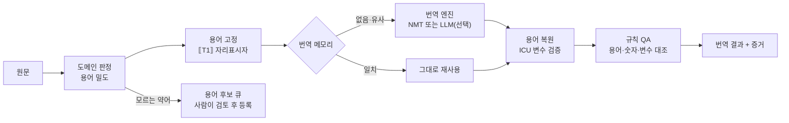

도메인 판정·용어 고정·번역 메모리는 브라우저에서 규칙으로 돌고, **LLM으로 번역**을 누르면 용어를 잠근 문장만 GoVail Gateway로 한 번 보냅니다. 돌아온 번역은 용어를 되돌리고 규칙 QA로 검사합니다. 용어집은 네트워크 보안 업계의 일반 용어만 담았습니다.

<DomainChecker />

<ProductFeatures />

## 이런 문제를 풉니다

[LingoAgent](/projects/lingo-agent)는 i18n 원문에서 바뀐 키만 번역하고, ICU 변수 검증과 QA를 통과한 결과만 커밋하는 CI 게이트입니다. 번역과 QA를 모두 LLM이 합니다.

보안 제품 문서를 번역해 보면 같은 실수가 반복됩니다. "단말"을 *terminal*로, "격리"를 *isolation*으로, "관제"를 *control*로 옮깁니다. 문장은 자연스러운데 업계 사람이 읽으면 틀린 번역입니다. 그리고 매번 LLM을 부르니 같은 문장도 비용이 들고 결과가 조금씩 달라집니다.

## 동작 방식 {#how}

LLM 앞에 **규칙으로 끝낼 수 있는 단계**를 먼저 둡니다. 대부분의 문장은 여기서 끝나고, LLM은 정말 필요할 때만 부릅니다.

<DiagramFrame caption="왼쪽 네 단계는 결정적(같은 입력이면 같은 결과)입니다. 번역 엔진은 갈아 끼울 수 있습니다.">

</DiagramFrame>

- **도메인 판정**: 용어집에 있는 말이 얼마나 나오는지로 이 문장이 업계 문장인지 정합니다. 일반 문장에는 도메인 규칙을 적용하지 않아 엉뚱한 치환을 막습니다.
- **용어 고정**: 찾은 용어를 자리표시자로 바꿔 번역 엔진이 손대지 못하게 하고, 번역 뒤 용어집 번역으로 되돌립니다.
- **번역 메모리**: 한 번 승인된 번역은 다음부터 그대로 씁니다. 비용 0, 결과가 매번 같습니다.
- **번역 엔진**: LLM 없이 가려면 OPUS-MT나 Argos Translate 같은 오픈소스 NMT를 CPU에서 돌립니다. 품질이 모자란 문장만 LLM으로 보냅니다.
- **용어 후보 큐**: 용어집에 없는 약어나 반복되는 명사를 모아 사람이 검토하고 등록합니다. 이 분야에서 실제로 쓰는 말인지는 사람이 정합니다.

## 로드맵

1. 미리 써보기에 LLM 번역과 규칙 QA 연결 — **완료**
2. 용어집을 YAML로 분리하고 Lingo CLI에 `--glossary` 옵션 추가
3. 번역 메모리 저장소(SQLite) 연결
4. OPUS-MT ko→en 모델을 CTranslate2로 띄워 LLM 대비 품질·속도 측정
5. 용어 후보 검토 화면

