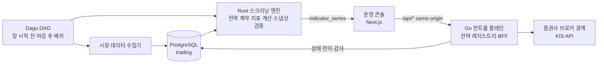

<ProductFeatures />

## 이런 문제를 풉니다

개인 계좌로 소액 실거래를 돌리는 시스템입니다. 이 페이지는 **구조와 안전 규칙만** 다룹니다. 보유 종목, 수량, 수익률, 전략 파라미터는 싣지 않고, 캡처할 때도 가립니다.

운영 콘솔은 로그인 뒤에 있습니다. 대신 같은 시세 DB를 **읽기 전용 권한**으로 읽는 공개 화면 [NS 마켓](https://ns.aircanvas.kr)을 열어 두었습니다. 상장사 공시 뒤 주가가 시장보다 어떻게 움직였는지, 같은 유형의 과거 공시 뒤에는 어땠는지를 보여 줍니다.

## 동작 방식 {#how}

<DiagramFrame caption="전략 상태를 바꾸는 쪽(Go)과 계산하는 쪽(Rust), 보여주는 쪽(콘솔)을 나눴습니다.">

</DiagramFrame>

## 안전 규칙

실거래 시스템에서 가장 무서운 것은 버그보다 **누가 언제 무엇을 바꿨는지 모르는 상태**입니다. 그래서 바꿀 수 있는 곳을 하나로 줄였습니다.

- 전략 상태(`TEST` → `ACTIVE` → `INACTIVE`)는 Go 컨트롤 플레인만 바꿉니다.
- 전략 정의, 파라미터 버전, 배포 이력, 감사 기록은 PostgreSQL이 소유하고 파라미터 버전은 바꾸지 않고 새로 쌓습니다. 컨트롤 플레인이 재시작돼도 그대로 복구됩니다.
- Rust 엔진은 실행 전에 스키마 버전, 상태, 만료, 파라미터 해시, 코드 해시를 검증합니다. 하나라도 다르면 계산하지 않습니다.
- 콘솔 차트는 엔진이 계산한 지표를 그대로 그리고, 화면에서 다시 계산하지 않습니다. 화면과 엔진이 다른 숫자를 보는 일을 막습니다.
- `TEST` 상태 전략이 실거래(`LIVE`)로 나가려 하면 `TEST_STRATEGY_LIVE_BLOCKED`로 거부합니다.

## 화면

<CaptureSlot title="전략 레지스트리와 상태 전이 이력" shot="trading console" :points="['전략 이름은 가명', '상태 배지와 전이 시각', '감사 기록 패널']" />
<CaptureSlot title="스크리닝 결과와 지표 차트" shot="trading console" :points="['종목명·코드 가림', '엔진 지표 시리즈 표시']" />
<CaptureSlot title="Dagu 배치 실행 기록" shot="dagu" :points="['DAG 그래프', '성공·실패 이력']" />

## 로드맵

1. 백테스트와 실거래 결과를 같은 화면에서 비교(수치는 비율로만 공개)
2. 브로커 장애 시 주문 상태 복구 시나리오 테스트

