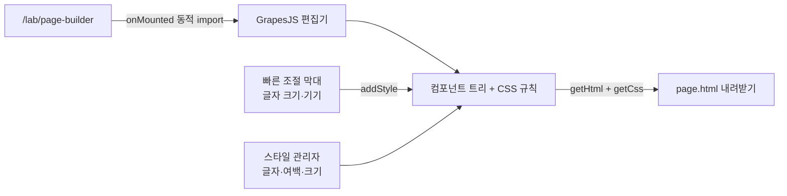

<PageBuilder />

<ProductFeatures />

## 이런 문제를 풉니다

간단한 소개 페이지 하나를 고치려고 개발자를 부르는 일을 줄입니다. 캔버스에서 영역을 고르고, 포토샵 속성 패널처럼 오른쪽에서 글자·여백·배경을 바꾸고, 끝나면 **HTML 파일 하나**로 받습니다. 받은 파일은 어디에 올려도 그대로 열립니다.

## 동작 방식 {#how}

<DiagramFrame caption="편집기는 이 페이지에서만 불러옵니다. 다른 페이지 번들에는 포함되지 않습니다.">

</DiagramFrame>

## 왜 GrapesJS인가

직접 만들기 전에 오픈소스를 먼저 비교했습니다.

| 후보 | 장점 | 이 작업에 안 맞는 점 |
|---|---|---|
| **GrapesJS** (BSD-3) | 프레임워크 무관, 스타일 관리자·레이어·기기별 미리보기 내장, HTML/CSS 내보내기 | 기본 UI가 무거워 테마를 덮어써야 함 |
| Craft.js (MIT) | React 컴포넌트 단위 편집이 깔끔 | 편집 UI를 거의 다 직접 만들어야 함 |
| Puck (MIT) | 데이터(JSON) 중심 페이지 구성 | 결과가 React 렌더링 전제라 HTML 파일 한 장과 거리가 있음 |
| Editor.js (Apache-2.0) | 블록 문서 편집에 강함 | 레이아웃·스타일 편집이 목적이 아님 |

"영역 선택 → 스타일 조절 → HTML로 받기"가 기본 기능으로 있는 것은 GrapesJS뿐이었습니다. 그래서 편집 엔진은 GrapesJS를 그대로 쓰고, 이 사이트의 톤에 맞춰 패널 색과 블록 목록, 위쪽 빠른 조절 막대만 손봤습니다.

## 로드맵

1. 프로젝트 JSON 저장과 불러오기
2. 이미지 업로드(지금은 주소 입력만)
3. 자주 쓰는 섹션 템플릿: 가격표, 자주 묻는 질문, 연락처
4. 내보내기 옵션: Tailwind 클래스로 변환

