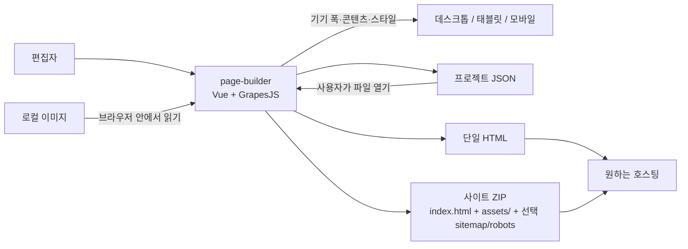

[page-builder 저장소](https://github.com/devcy0922/page-builder)의 독립 앱이며, [브라우저에서 바로 열 수 있습니다](https://devcy0922.github.io/page-builder/). 이 사이트에는 제품 설명만 두고 GrapesJS 편집기와 이미지는 따로 싣지 않습니다.

## 직접 고치고, 원하는 형태로 저장

대장간 예시를 열어 영역을 고치거나 블록을 더합니다. 데스크톱·태블릿·모바일 폭으로 전환하고, 모바일에서 가로로 넘치는지 확인합니다. 작은 화면에서는 편집 패널을 열어 속성을 조절할 수 있습니다.

- **HTML:** CSS와 로컬 이미지를 안에 포함한 한 파일
- **사이트 ZIP:** index.html과 assets/를 나눈 정적 사이트 묶음. 대표 주소를 넣으면 sitemap.xml과 robots.txt도 포함
- **프로젝트 JSON:** 편집 화면과 메타데이터를 보관해 나중에 다시 열기

이미지와 페이지 내용은 브라우저 안에서 처리합니다. 계정이나 편집 내용 업로드 API가 없습니다. 이 앱은 사이트를 게시하지 않으며, 내려받은 파일을 원하는 호스팅이나 미리보기 도구에 직접 올립니다.

## 검색과 공유를 위한 점검

페이지 제목과 설명, canonical 주소, 공유 이미지, h1과 소제목 순서, 이미지 대체 텍스트, 링크 이름, 본문 설명을 내보내기 전에 살핍니다. JSON-LD는 선택 사항이며, 직접 입력한 올바른 JSON만 내보냅니다.

GEO는 별도 AI 태그나 점수로 해결되지 않습니다. 질문에 답하는 본문, 사실을 확인할 수 있는 작성자·업체 정보와 출처, 공개된 사이트의 크롤링 설정을 챙기는 편집 보조를 제공합니다. [Google의 검색 AI 기능 안내](https://developers.google.com/search/docs/appearance/ai-features)도 SEO 기본 원칙이 계속 적용되며, AI 기능을 위한 특별한 마크업은 없다고 설명합니다. 이 도구는 검색 순위나 AI 답변 수록을 보장하지 않습니다.

사이트를 ZIP으로 받아 배포하는 흐름은 준비되어 있습니다. web-preview 코드를 가져오거나 연결하지 않으며, 미리보기 도구와의 직접 전송은 이후 공개·인증 경계와 사용 방식을 정한 뒤 검토할 항목입니다.

## 동작 방식 {#how}

<DiagramFrame caption="편집과 저장은 브라우저 안에서 이뤄집니다. 게시 위치는 사용자가 선택합니다.">

</DiagramFrame>

## 현재 범위

| 영역 | 현재 기능 |
|---|---|
| 편집 | 영역 선택, 텍스트·스타일·이미지 조절, 기본 섹션 블록 |
| 반응형 | 데스크톱·태블릿·모바일 프리뷰와 가로 넘침 점검 |
| 검색 기초 | 제목·설명·canonical·공유 미리보기·제목 구조·alt 점검 |
| 저장 | HTML, 여러 파일 사이트 ZIP, 편집 프로젝트 JSON |
| 범위 | 브라우저 로컬 처리. 계정, 서버 저장, 게시 기능 없음 |

다음은 실제로 써 보며 자주 쓰는 섹션 템플릿과 여러 페이지 구성, 내보낸 파일의 게시·미리보기 인계 흐름을 다듬습니다.

