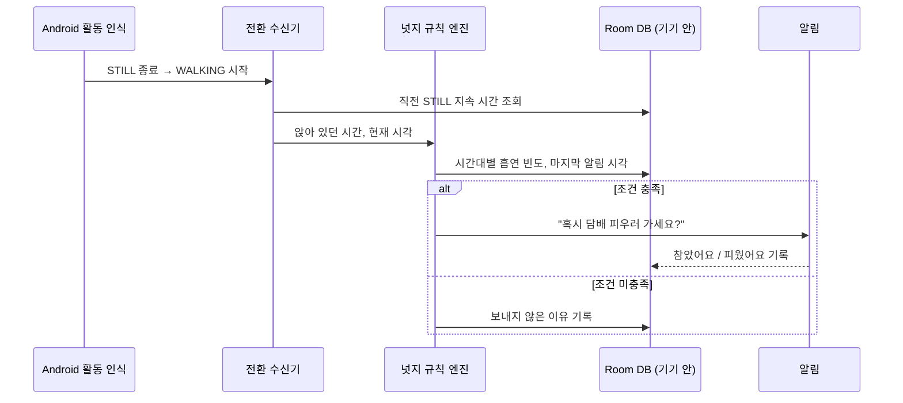

앱에 들어갈 규칙을 그대로 옮겼습니다. 하루 패턴을 고르거나 칸을 눌러 바꿔 보면, 알림을 보내는 순간과 보내지 않는 순간이 이유와 함께 나옵니다.

<QuitSimulator />

<ProductFeatures />

## 이런 문제를 풉니다

담배는 대부분 습관적인 순간에 피웁니다. 회의가 끝나고, 점심을 먹고, 오래 앉아 있다가 일어날 때. 휴대폰은 그 순간을 압니다. **앉아 있다가 걷기 시작한 순간**, 그리고 그게 평소 담배를 피우던 시간대라면, 앱이 조용히 묻습니다.

> 1시간 20분 앉아 있다가 걷기 시작했어요. 혹시 담배 피우러 가세요?

혼내지 않고, 막지 않고, 지금까지 참은 시간만 보여줍니다. 답(참았어요·피웠어요)은 다음 알림 시간대를 고르는 데 씁니다.

## 동작 방식 {#how}

걸음 센서를 계속 켜 두면 배터리가 빨리 닳습니다. 그래서 **활동 전환(Activity Recognition Transition API)** 으로 "가만히 있음 → 걷기" 이벤트만 받습니다. 시스템이 이미 계산하는 값을 받기 때문에 앱은 대부분 잠들어 있습니다.

<DiagramFrame caption="모든 기록은 휴대폰 안에만 저장합니다. 서버가 없습니다.">

</DiagramFrame>

| 구성 | 선택 | 이유 |
|---|---|---|
| 걷기 감지 | Activity Recognition Transition API | 상시 센서 대비 배터리 소모가 적고 "전환" 순간만 받습니다. |
| 걸음 수 기록 | Health Connect | 하루 걸음 추이를 다른 앱과 같은 출처로 보여줍니다. |
| 일일 요약 | WorkManager | 밤에 한 번 시간대별 흡연 빈도를 다시 계산합니다. |
| 저장 | Room (기기 안) | 흡연 기록은 민감 정보라 서버로 보내지 않습니다. |
| 권한 | `ACTIVITY_RECOGNITION`, `POST_NOTIFICATIONS` | 첫 실행 때 왜 필요한지 설명하고 요청합니다. |

## 로드맵

1. 규칙 엔진을 Kotlin으로 옮기고, 시뮬레이터와 같은 입력으로 같은 결과가 나오는지 테스트
2. 활동 전환 수신 + 알림 최소 앱
3. 1주일 직접 써 보며 알림 빈도와 피로도 조정

