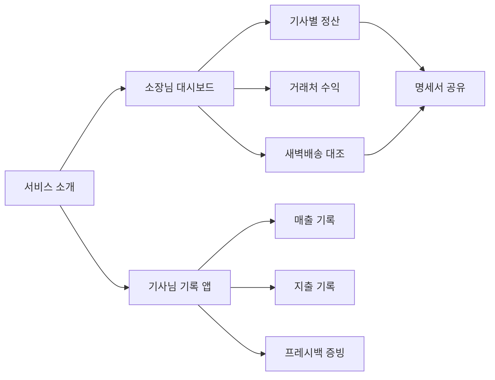
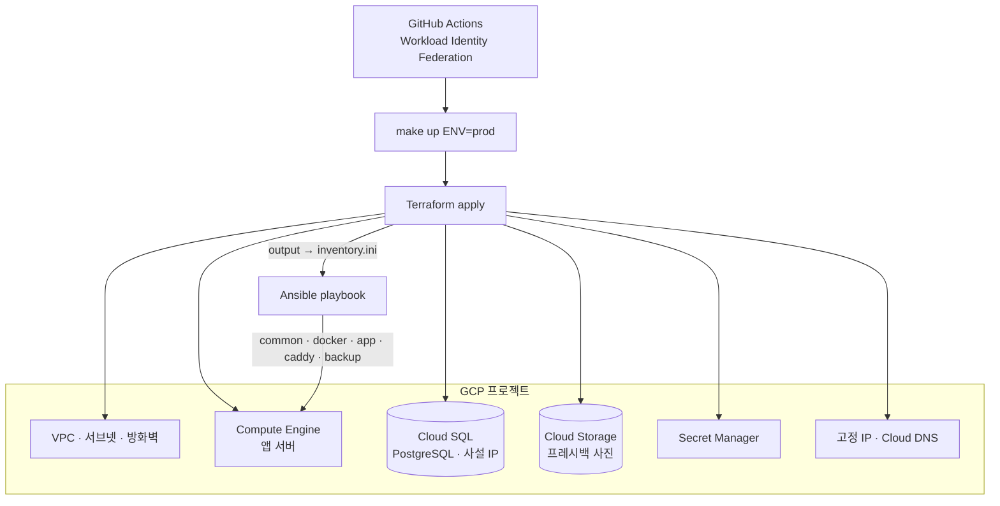

<div class="product-body vp-doc">

<ProductFeatures />

## 이런 문제를 풉니다

쿠팡 새벽배송을 맡는 대리점은 소장님이 기사님 수십 명의 배송 건수, 프레시백 회수, 거래처별 단가를 엑셀로 맞춥니다. 기사님은 그날 번 돈과 쓴 돈을 따로 메모합니다. 새벽온은 이 둘을 한 서비스로 묶습니다. 쿠팡과 제휴한 서비스가 아니라 대리점 운영을 돕는 독립 프로젝트입니다.

<DiagramFrame caption="첫 화면에서 오늘의 정산 상태와 바로 입력할 현장 기록을 함께 봅니다.">



</DiagramFrame>

지금은 프런트엔드 프로토타입입니다. 기사님 화면에서 입력한 매출·지출·프레시백 증빙이 브라우저 저장소에 쌓이고, 소장님 화면의 대조 패널과 CSV 리포트에 반영됩니다. 다음 단계가 서버와 인프라입니다.

## 동작 방식 {#how}

목표는 **빈 GCP 프로젝트에서 `make up` 한 번**으로 서비스가 뜨는 것입니다. 콘솔에서 손으로 만든 리소스는 하나도 없게 합니다.

<DiagramFrame caption="Terraform이 만든 결과(서버 주소)를 Ansible 인벤토리로 넘겨 두 도구 사이에 사람이 끼지 않게 합니다.">



</DiagramFrame>

```text
saebyeok-on-infra/
├── Makefile                  # up / plan / down / deploy ENV=dev|prod
├── terraform/
│   ├── modules/{network,compute,database,storage,secrets,dns}
│   ├── envs/dev/  envs/prod/ # backend: GCS 버킷(상태 잠금)
│   └── outputs.tf            # VM IP → ansible 인벤토리 생성
└── ansible/
    ├── inventory/            # terraform output으로 생성, 커밋하지 않음
    ├── roles/
    │   ├── common/           # 사용자, ufw, fail2ban, 자동 보안 업데이트
    │   ├── docker/
    │   ├── app/              # compose pull·up, 헬스체크 대기
    │   ├── caddy/            # TLS 자동 발급
    │   └── backup/           # Cloud SQL 내보내기 + GCS 수명주기
    └── site.yml
```

### 설계 결정

| 결정 | 이유 |
|---|---|
| Cloud Run 대신 Compute Engine 1대 + Docker Compose | 대리점 한두 곳 규모에서는 VM 한 대가 가장 싸고 문제 추적이 쉽습니다. 규모가 커지면 앱 컨테이너만 Cloud Run으로 옮깁니다. |
| DB는 Cloud SQL 사설 IP | 정산 데이터는 돈과 직결됩니다. 백업·패치를 관리형에 맡기고 외부 노출을 없앱니다. |
| CI는 서비스 계정 키 파일 없이 Workload Identity Federation | 유출될 수 있는 장기 키를 만들지 않습니다. |
| 시크릿은 Secret Manager, Ansible은 실행 시점에 읽기 | 저장소와 인벤토리에 비밀이 남지 않습니다. |
| `make down`으로 전부 삭제 가능, 단 prod DB는 삭제 보호 | 데모 환경은 쉽게 지우고, 운영 데이터는 실수로 못 지우게 합니다. |

## 화면

<div class="capture-grid">
<CaptureSlot title="서비스 소개" shot="saebyeok-on" :points="['가치 제안 한 줄', '소장님·기사님 진입 버튼']" />
<CaptureSlot title="소장님 대시보드: 오늘의 정산" shot="saebyeok-on/owner" :points="['기사별 정산 표', '새벽배송 대조 결과', '샘플 데이터 표시']" />
<CaptureSlot title="기사님 기록 앱" shot="모바일" device="mobile" size="390 × 844" :points="['오늘 매출·지출', '프레시백 사진 증빙 버튼']" />
<CaptureSlot title="make up 실행 로그" shot="terminal" :points="['terraform apply 요약', 'ansible PLAY RECAP', '헬스체크 통과']" />
</div>

## 로드맵

1. API 서버와 PostgreSQL 스키마(정산 기간, 기사, 거래처 단가, 증빙)
2. Terraform 모듈과 Ansible 역할 작성, dev 환경에서 `make up`부터 `make down`까지 검증
3. 명세서 PDF 생성과 카카오톡 공유

</div>
