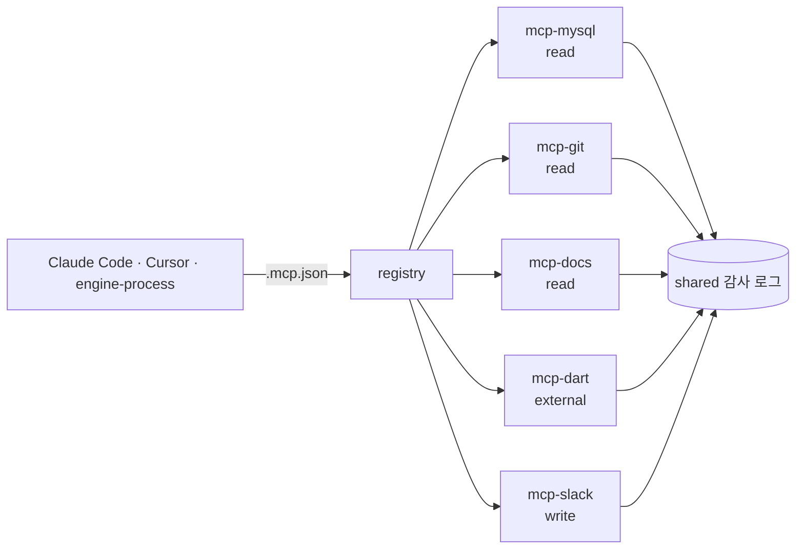

<div class="product-body vp-doc">

<ProductFeatures />

## 이런 문제를 풉니다

MCP 서버를 하나씩 만들다 보면 저장소마다 인증, 로그, 테스트, 클라이언트 설정 방법이 달라집니다. 새 서버를 붙일 때마다 같은 결정을 다시 합니다. 그래서 **규칙은 루트에 한 번, 서버는 디렉토리 하나**로 정했습니다.

```text
vibe-mcp/
├── Makefile                 # 모든 mcp-*를 같은 명령으로 다룸
├── mcp.schema.json          # 각 서버 manifest 형식
├── shared/                  # 공통: 설정 로딩, 감사 로그, 결과 크기 제한
├── templates/mcp-ts/        # make new NAME=... 의 뼈대
├── mcp-mysql/               # 읽기 전용 SQL 조회
├── mcp-git/                 # 저장소 이력·diff 조회
├── mcp-docs/                # Markdown 문서 검색
├── mcp-dart/                # OpenDART 공시 조회 (vibe-post-it와 공유)
└── mcp-slack/               # Block Kit 메시지 전송
```

각 `mcp-*` 디렉토리는 세 가지만 지키면 됩니다.

1. `mcp.yaml` manifest: 이름, 전송 방식(stdio·HTTP), 도구 목록, 위험 등급(read·write·external)
2. 자체 `Makefile`에 `build`, `test`, `run` 타깃
3. `README.md`에 도구별 입력·출력 예시

## 동작 방식 {#how}

```make
SERVERS := $(patsubst %/,%,$(wildcard mcp-*/))

list:                    ## 서버 목록과 위험 등급
	@for s in $(SERVERS); do printf "%-14s %s\n" $$s "$$(yq '.risk' $$s/mcp.yaml)"; done

build test lint:         ## 모든 서버에 같은 타깃 실행
	@for s in $(SERVERS); do $(MAKE) -C $$s $@ || exit 1; done

run:                     ## make run MCP=mysql
	@$(MAKE) -C mcp-$(MCP) run

inspect:                 ## MCP Inspector로 도구 확인
	npx @modelcontextprotocol/inspector $(MAKE) -C mcp-$(MCP) run

new:                     ## make new NAME=jira
	cp -r templates/mcp-ts mcp-$(NAME) && sed -i "s/__NAME__/$(NAME)/g" mcp-$(NAME)/mcp.yaml

registry:                ## 클라이언트 설정(.mcp.json) 생성
	node scripts/registry.mjs $(SERVERS) > .mcp.json
```

## mcp-mysql 안전장치

DB를 에이전트에게 여는 서버라 가장 먼저, 가장 엄격하게 만듭니다.

| 위험 | 막는 방법 |
|---|---|
| 데이터 변경 | 읽기 전용 DB 계정 + SQL 파서로 `SELECT`·`SHOW`·`EXPLAIN`만 통과 |
| 무거운 쿼리 | `MAX_EXECUTION_TIME` 힌트, 결과 행 수 상한 |
| 민감 컬럼 | 컬럼 이름 패턴(`password`, `token`, `ssn`) 마스킹 |
| 접속 정보 노출 | DSN은 환경변수로만, 도구 결과·로그에 출력하지 않음 |
| 추적 불가 | 모든 호출을 shared 감사 로그에 기록(질의 해시, 행 수, 소요 시간) |

<DiagramFrame caption="클라이언트는 registry로 만든 설정 하나로 필요한 서버만 켭니다. 모델 호출은 GoVail Gateway를 거칩니다.">



</DiagramFrame>

## 로드맵

1. 저장소 생성, 루트 Makefile과 템플릿
2. mcp-mysql 구현과 테스트(쓰기 쿼리 거부 케이스부터)
3. mcp-dart: vibe-post-it 사업보고서 비교와 연결
4. write 등급 서버는 사람 승인을 거치도록 engine-process 승인 게이트와 연결

</div>
